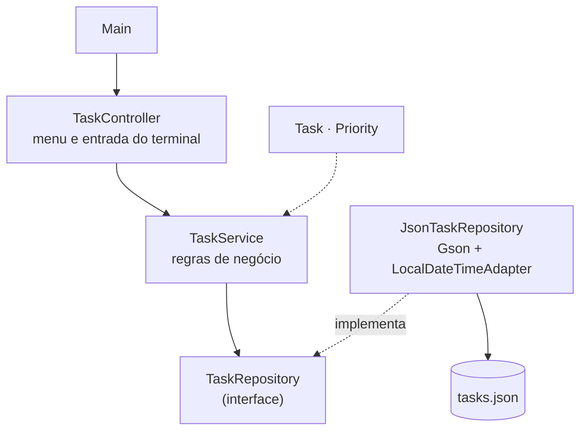
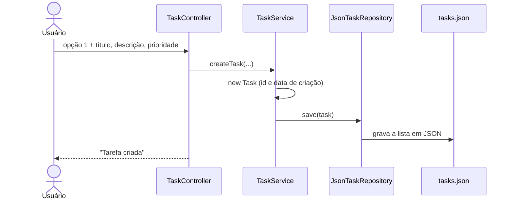

<div align="center">


# ❖ JCore
### Java puro, do menu ao arquivo

**Gerenciador de tarefas em linha de comando, escrito em Java 17 sem frameworks.**
Menu interativo no terminal, camadas separadas (controller, service, repository),<br/>
persistência em JSON com Gson e datas tratadas com `LocalDateTime`.


</div>

---

## 👨‍💻 Autor

<table>
  <tr>
    <td width="62%">

Eu sou o **Gustavo Osterno Thé**, e o **JCore** é um dos projetos do meu portfólio público. Idealizei, desenvolvi e mantenho este repositório.

Antes de usar qualquer framework, quis provar que sei organizar um programa Java **só com a linguagem**: separar responsabilidades em camadas, persistir dados em arquivo e tratar entrada do usuário com segurança. É a base que depois aprofundo, com design patterns, JDBC e testes, no [Nidavellir](https://github.com/GustavoThe01/nidavellir-inventory).

    </td>
    <td width="38%">

| | |
|---|---|
| 🌐 Site | [site-gustavothe-dev.web.app](https://site-gustavothe-dev.web.app/) |
| 💼 LinkedIn | [gustavoosterno](https://www.linkedin.com/in/gustavoosterno/) |
| 🐙 GitHub | [@GustavoThe01](https://github.com/GustavoThe01) |
| 📸 Instagram | [@gustavo.osterno](https://www.instagram.com/gustavo.osterno) |

    </td>
  </tr>
</table>

---

## 📑 Sumário

- [Em números](#-em-números)
- [A origem do nome](#-a-origem-do-nome)
- [O que o sistema faz](#-o-que-o-sistema-faz)
- [Menu do terminal](#-menu-do-terminal)
- [Arquitetura](#️-arquitetura)
- [Como uma tarefa é salva](#-como-uma-tarefa-é-salva)
- [Competências demonstradas](#-competências-demonstradas)
- [Metodologias e decisões](#-metodologias-e-decisões)
- [Roadmap](#️-roadmap)
- [Como rodar](#-como-rodar)
- [Testes](#-testes)
- [Estrutura do projeto](#-estrutura-do-projeto)
- [O que ainda falta](#-o-que-ainda-falta)
- [Projetos relacionados](#-projetos-relacionados)

---

## 📊 Em números

<div align="center">

| ☕ Linguagem | 🧱 Design | 💾 Dados | 🗓️ Processo |
|:---:|:---:|:---:|:---:|
| **Java 17**, zero frameworks | **4** camadas (controller, service, repository, model) | arquivo **`tasks.json`** | **2** commits · fev/2026 |
| switch expressions e lambdas | repositório por **interface** | Gson com adaptador de `LocalDateTime` | build com Maven |
| **1** dependência (Gson) | **5** operações no menu | **3** níveis de prioridade | versão **concluída** |

<sub>Números do estado atual do repositório. O que vem a seguir está em <a href="#-o-que-ainda-falta">O que ainda falta</a>.</sub>

</div>

---

## ❖ A origem do nome

> *Todo sistema grande começa com um núcleo pequeno que funciona.*

**J** de Java e **Core** de núcleo. O JCore é exatamente isso: o essencial de um gerenciador de tarefas, sem nada que a linguagem não ofereça por conta própria.

---

## ✨ O que o sistema faz

| Recurso | O que resolve |
|---|---|
| ➕ **Criar** | Nova tarefa com título, descrição e prioridade |
| 📋 **Listar** | Todas as tarefas, com status e datas |
| ✏️ **Atualizar** | Altera título, descrição e prioridade |
| ✅ **Concluir** | Marca a tarefa como feita e registra a data de conclusão |
| 🗑️ **Remover** | Exclui a tarefa |
| 💾 **Persistir** | Salva tudo em `tasks.json`, que sobrevive ao fechamento do programa |

---

## 🌐 Menu do terminal

```text
1. Nova Tarefa
2. Listar Tarefas
3. Atualizar Tarefa
4. Remover Tarefa
5. Concluir Tarefa
6. Sair
```

Prioridades aceitas: `BAIXA`, `MEDIA`, `ALTA` (um `enum` impede valores soltos como "mais ou menos").

---

## 🏛️ Arquitetura

O controller só conversa com o usuário; as regras ficam no serviço; o serviço depende de uma **interface** de repositório, não do arquivo JSON.



---

## 🔄 Como uma tarefa é salva



---

## 🧠 Competências demonstradas

| Área | Conceitos |
|---|---|
| **Java moderno** | Switch expressions, lambdas, `Optional`, `LocalDateTime` |
| **POO** | Encapsulamento, enum para domínio fechado, separação de responsabilidades |
| **Arquitetura** | Camadas, inversão de dependência com interface de repositório |
| **Persistência** | Serialização e desserialização JSON com Gson e `TypeAdapter` |
| **CLI** | Menu interativo, leitura e validação de entrada com `Scanner` |
| **Build** | Projeto Maven com dependência gerenciada |

---

## 🧭 Metodologias e decisões

- **Interface antes da implementação**: trocar o JSON por um banco exige só um novo `TaskRepository`.
- **Enum de prioridade** em vez de texto livre, para que o domínio só aceite valores válidos.
- **Sem framework de propósito**: o objetivo é mostrar o que a linguagem faz sozinha.

---

## 🗺️ Roadmap

| Fase | Tema | Versão | Progresso |
|---|---|:---:|---|
| 1 | CRUD no terminal com persistência em JSON | `v1.0.0` | 🟩🟩🟩🟩🟩 |
| 2 | Limpeza do repositório, testes com JUnit 5 e CI | `v1.1.0` | ⬜⬜⬜⬜⬜ |
| 3 | Filtros, busca e relatórios com Streams | `v1.2.0` | ⬜⬜⬜⬜⬜ |

---

## 🚀 Como rodar

**Pré-requisitos:** [JDK 17+](https://adoptium.net/) e [Maven](https://maven.apache.org/).

```bash
git clone https://github.com/GustavoThe01/jcore-task-manager.git
```

```bash
cd jcore-task-manager
```

```bash
mvn compile exec:java -Dexec.mainClass=com.jcoremanager.Main
```

As tarefas ficam salvas em `tasks.json`, na pasta onde o programa foi executado.

---

## 🧪 Testes

Ainda não há testes automatizados neste repositório. O plano:

| Tipo | Ferramenta | Situação |
|---|---|---|
| Unitários do `TaskService` (com repositório em memória) | JUnit 5 | ⏳ Planejado |
| Persistência (`JsonTaskRepository` em pasta temporária) | JUnit 5 | ⏳ Planejado |

---

## 📁 Estrutura do projeto

```
jcore-task-manager/
├── src/main/java/com/jcoremanager/
│   ├── Main.java                     # ✅ ponto de entrada
│   ├── controller/TaskController.java # ✅ menu do terminal
│   ├── service/TaskService.java      # ✅ regras de negócio
│   ├── repository/
│   │   ├── TaskRepository.java       # ✅ interface
│   │   └── JsonTaskRepository.java   # ✅ persistência com Gson
│   ├── model/                        # ✅ Task, Priority
│   └── util/LocalDateTimeAdapter.java # ✅ datas no JSON
├── src/main/java/com/taskflow/       # ⚠️ cópia antiga do mesmo código (a remover)
├── docs/assets/                      # ✅ banner
├── pom.xml                           # ✅ Java 17 + Gson
└── index.html · index.tsx · vite.config.ts · package.json  # ⚠️ sobras do template (a remover)
```

---

## 🧩 O que ainda falta

Mantenho aqui um checklist vivo do que ainda vou incrementar neste repositório.

**Projeto**
- [x] Criar, listar, atualizar, concluir e remover tarefas
- [x] Persistência em JSON com datas
- [ ] Remover o pacote duplicado `com.taskflow` e os arquivos de front-end que sobraram do template
- [ ] Declarar o `exec-maven-plugin` e o `mainClass` no `pom.xml` (rodar com `mvn exec:java`)
- [ ] Testes com JUnit 5 e GitHub Actions
- [ ] Filtros por prioridade e status com Streams

**README**
- [ ] GIF do menu em uso
- [ ] Definir e adicionar uma licença (`LICENSE`)

---

## 🔗 Projetos relacionados

| Projeto | Stack | Relação |
|---|---|---|
| ⚒ [Nidavellir](https://github.com/GustavoThe01/nidavellir-inventory) | Java 21 | **A evolução deste projeto**: design patterns, JDBC com transações e testes |
| ◆ [CorePlan](https://github.com/GustavoThe01/coreplan-api) | Spring Boot 3 | O mesmo domínio de tarefas, agora como API REST |
| ♾ [Moirai](https://github.com/GustavoThe01/moirai-taskflow) | Spring Boot 4 | Tarefas com Arquitetura Hexagonal e segurança |
| ☑ [ThéTask](https://github.com/GustavoThe01/taskboard-react-ts) | React | Tarefas num quadro Kanban no navegador |
| ❖ **JCore** | Java 17 | *você está aqui* |

<div align="center">

<sub>Escrito por mim, linha por linha, em Java puro · <a href="https://github.com/GustavoThe01">Gustavo Osterno Thé</a></sub>

</div>
